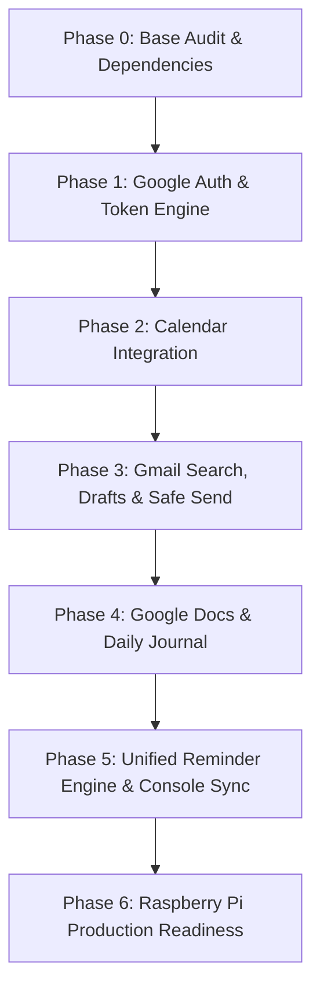

# DeskOS v2 Technical Architecture, Feasibility & Phased Execution Plan

**Document Version:** 2.0.0-PROPOSAL  
**Author:** Antigravity AI Assistant  
**Target Environment:** Current Ubuntu Linux Laptop (Dell Vostro 3405) → Target 24/7 Raspberry Pi 4 Model B (8GB RAM)  
**Dedicated Display Target:** Realme C2 in Landscape Car Console mode (`100vh` zero-scroll)

---

## 1. Feasibility Assessment

### 1.1 Technical Feasibility: **HIGH (Feasible with Zero Recurring Cost)**
- **Runtime Environment:**
  - Python 3.10+ standard library (`http.server`, `sqlite3`, `threading`, `queue`, `urllib.request`) forms the core of DeskOS.
  - The official Google API Python client (`google-api-python-client`, `google-auth-httplib2`, `google-auth-oauthlib`) is fully compatible with standard Linux x86_64 (laptop) and ARM64 / aarch64 (Raspberry Pi 4 running Raspberry Pi OS or Ubuntu Server).
- **RAM & CPU Budget:**
  - Current idle DeskOS usage: ~45–60 MB RAM, <2% CPU.
  - Adding the Google API client modules in a lazy-loaded architecture will add approximately 25–40 MB RAM during API interaction.
  - On the Raspberry Pi 4 (8GB RAM), the total memory footprint will be **< 120 MB**, leaving > 7.5 GB for OS buffers and local caches.
- **Cost Feasibility: $0 / Month**:
  - **Google Workspace APIs (Calendar, Gmail, Docs)**: Available under the standard Google Cloud Free Tier for personal developer projects. Standard user quotas (e.g., 250 requests/sec for Calendar, 1 billion quota units/day for Gmail, 300 requests/min for Docs) far exceed a personal desk assistant's usage.
  - **Gemini 2.5 Flash Lite**: Operates within Google AI Studio's free tier (15 RPM / 1M TPM).
  - No external paid services, SaaS relays, or monthly subscriptions are required.

### 1.2 Architectural Extension Points (Zero-Breaking Guarantee)
The current codebase is already organized cleanly for plug-and-play extension:
1. **`gemini_adapter.py`**: Accepts user context, prompts Gemini with JSON schemas, and returns an `action`, `parameters`, and `reply`. Adding actions (`list_calendar_events`, `create_calendar_event`, `search_emails`, `create_email_draft`, `send_email`, `create_daily_doc_summary`) is a strict superset of the existing actions.
2. **`assistant.py` (`AssistantRouter`)**: Dispatches Gemini's returned action to local store functions. We will introduce modular service adapters (`GoogleCalendarService`, `GmailService`, `GoogleDocsService`) called directly from `AssistantRouter`.
3. **`server.py`**: Asynchronous FIFO worker queue (`AssistantWorker`) handles slow API queries without blocking the frontend HTTP server or SSE stream.
4. **`static/index.html`**: The Car Console UI with deep-linked routes (`/cockpit`, `/tasks`, `/reminders`, `/voice`, `/analytics`, `/ambient`) provides clean hooks for new Workspace cards (e.g., Agenda Deck or Draft Confirmation modal).

---

## 2. Requirements & Setup Checklist (What We Need From You)

To implement this without friction, here is the setup you will need to prepare from your end:

### Checklist:
1. **Google Cloud Console Project**:
   - Go to [Google Cloud Console](https://console.cloud.google.com/).
   - Create a project named `DeskOS-Personal` (or select an existing personal project).
2. **Enable Required Google APIs**:
   - In **APIs & Services > Library**, enable:
     - **Google Calendar API**
     - **Gmail API**
     - **Google Docs API**
     - **Google Drive API** (required for creating/locating Docs in Drive folders)
3. **OAuth Consent Screen Configuration**:
   - In **APIs & Services > OAuth consent screen**:
     - User Type: **External** (standard for personal Gmail accounts `@gmail.com`).
     - App Name: `DeskOS Companion`.
     - User Support Email: your personal Gmail.
     - Publishing Status: **Testing** (keeps it private to your account).
     - Test Users: Add your personal Gmail address (`yourname@gmail.com`).
4. **OAuth 2.0 Client Credentials**:
   - In **APIs & Services > Credentials > Create Credentials > OAuth client ID**:
     - Application Type: **Desktop app** (or **Web application** with redirect URI `http://localhost:8765/api/oauth2callback`).
     - *Recommendation:* **Desktop App** OAuth client is easiest for headless/Pi servers (supports local port authorization and offline refresh tokens).
     - Download the JSON credential file and name it `credentials.json` (do **not** commit this to Git).
5. **No Billing Card Required**:
   - For standard personal testing with your own account under API quotas, Google Cloud does not require a paid billing account for Calendar/Gmail/Docs.

---

## 3. Phased Task Breakdown & Execution Plan

We will execute this systematically in 6 distinct phases.



---

### Phase 1: Google Auth & Token Management Engine
- **Objective:** Establish secure OAuth2 authentication, offline refresh token persistence, and automatic credential refresh without interactive re-logins.
- **Key Modules to Create:**
  - `workspace_auth.py`: Handles OAuth2 flow using `google-auth-oauthlib`.
  - Storage: Stores encrypted/protected token in `data/token.json` (with strict `0600` permissions and `.gitignore` exclusion).
  - Scope Strategy: Least privilege:
    - Calendar: `https://www.googleapis.com/auth/calendar.events`
    - Gmail: `https://www.googleapis.com/auth/gmail.readonly`, `https://www.googleapis.com/auth/gmail.compose`, `https://www.googleapis.com/auth/gmail.send`
    - Docs: `https://www.googleapis.com/auth/documents`, `https://www.googleapis.com/auth/drive.file`
- **Tasks:**
  - [ ] **Task 1.1**: Install verified dependencies (`google-api-python-client`, `google-auth-httplib2`, `google-auth-oauthlib`).
  - [ ] **Task 1.2**: Write `workspace_auth.py` with `get_credentials()`, token expiration checking, and automatic refresh.
  - [ ] **Task 1.3**: Add `/api/workspace/status` endpoint in `server.py` to report Google connection status to the Car Console.
  - [ ] **Task 1.4**: Add a one-time CLI setup script `python3 -m scripts.setup_google_auth` to authenticate locally on laptop and store `data/token.json`.

---

### Phase 2: Google Calendar Integration
- **Objective:** Enable DeskOS to query upcoming meetings, schedule events, update time slots, and announce the day's schedule via voice.
- **Key Capabilities:**
  - Query: *"Hello Desk, what meetings do I have today?"* / *"What is my next meeting?"*
  - Create: *"Schedule a meeting with Team tomorrow at 4 PM"*
  - Update: *"Move my next meeting to 5 PM"*
  - Delete with Confirmation: *"Cancel the meeting at 4 PM"* (requires explicit voice or UI confirmation).
- **Tasks:**
  - [ ] **Task 2.1**: Implement `services/calendar_service.py` with standard CRUD interfaces (`get_today_events`, `get_upcoming_events`, `create_event`, `update_event`, `delete_event`).
  - [ ] **Task 2.2**: Integrate `Asia/Kolkata` timezone resolver with RFC3339 datetime conversions.
  - [ ] **Task 2.3**: Extend `gemini_adapter.py` schema with `list_calendar_events`, `create_calendar_event`, `update_calendar_event`, `delete_calendar_event`.
  - [ ] **Task 2.4**: Wire `assistant.py` to route Calendar intents into `calendar_service.py`.
  - [ ] **Task 2.5**: Add an Agenda view or modal to the Car Console Cockpit/Tasks deck.

---

### Phase 3: Gmail Integration (Search, Summarize, Draft & Safe Send)
- **Objective:** Give DeskOS the ability to search unread or specific emails, summarize lengthy threads using Gemini, draft replies, and send emails *strictly after double-confirmation*.
- **Safety Boundary:**
  - Drafting and sending are **strictly decoupled**.
  - Drafts can be revised verbally.
  - Sending requires an explicit verbal *"Yes, send it"* or tapping a red **CONFIRM SEND** button on the Realme C2 screen.
- **Tasks:**
  - [ ] **Task 3.1**: Implement `services/gmail_service.py` with `search_messages`, `get_message_summary`, `create_draft`, `update_draft`, `send_draft`.
  - [ ] **Task 3.2**: In `gemini_adapter.py`, inject only minimal sanitized snippets (sender, subject, snippet) into LLM context to preserve privacy and minimize token usage.
  - [ ] **Task 3.3**: Implement the two-step confirmation state machine in `assistant.py` (Draft Created -> User Review -> Explicit Confirmation -> Send).
  - [ ] **Task 3.4**: Display a tactile Draft Review card on the Car Console Voice deck with clear Recipient, Subject, and Preview text.

---

### Phase 4: Google Docs Integration & Daily Desk Journal
- **Objective:** Enable automatic end-of-day summary logs and voice notes appended to a dedicated Google Doc in Drive.
- **Key Capabilities:**
  - *"Hello Desk, note down that I fixed the speech loop issue"*
  - *"Hello Desk, create today's summary and save to Google Docs"*
  - Automatically compiles:
    - Date and Workstation Uptime
    - Completed DeskOS Tasks
    - Focus Minutes Logged
    - Calendar Events attended
    - Spoken Voice Notes
- **Tasks:**
  - [ ] **Task 4.1**: Implement `services/docs_service.py` with `get_or_create_daily_journal(date_str)` and `append_text(doc_id, text)`.
  - [ ] **Task 4.2**: Build the summary aggregator in `assistant.py` combining `reminder_store.get_desk_analytics()`, completed tasks from SQLite, and Calendar event logs.
  - [ ] **Task 4.3**: Add voice command handling in `gemini_adapter.py` for `log_quick_note` and `create_daily_doc_summary`.

---

### Phase 5: Unified Reminder Engine & Local/Google Sync
- **Objective:** Bridge local SQLite reminders with Google Calendar without creating conflicting schedules or losing offline independence.
- **Architecture:**
  - **Local First:** Local SQLite database remains the primary operational source of truth. If the internet or Google API drops, DeskOS alarms still trigger on time.
  - **Bi-directional Reflection:** When online, creating a reminder in DeskOS automatically creates a synchronized event in Google Calendar with a `deskos_id` private extended property.
- **Tasks:**
  - [ ] **Task 5.1**: Add `google_event_id` and `sync_status` columns to `reminders` table in `reminder_store.py`.
  - [ ] **Task 5.2**: Add background reconciliation thread in `server.py` that checks for Google Calendar status every 5 minutes without blocking the main event loop.
  - [ ] **Task 5.3**: Update Car Console `/reminders` UI to display a subtle Google Sync icon next to synchronized reminders.

---

### Phase 6: Raspberry Pi 4 Deployment & Hardening
- **Objective:** Package DeskOS v2 into a 24/7 autonomous service ready for seamless transfer from the Ubuntu laptop to the Raspberry Pi.
- **Tasks:**
  - [ ] **Task 6.1**: Create `systemd/deskos.service` with auto-restart on failure, memory limits, and non-root execution.
  - [ ] **Task 6.2**: Add local SQLite database automated backup script (`data/backups/`).
  - [ ] **Task 6.3**: Benchmark memory and CPU under simulated full-load (SSE stream + STT capture + Calendar sync).
  - [ ] **Task 6.4**: Document the deployment guide (`DEPLOY_PI.md`) with zero-downtime instructions.

---

## 4. Proposed File-Level Modifications

```
deskos/
├── assistant.py              <- Add Workspace intent handlers & confirmation state machine
├── gemini_adapter.py         <- Add Workspace action schemas & prompt rules
├── reminder_store.py         <- Add sync fields & migration for Google Event IDs
├── server.py                 <- Add /api/workspace endpoints & background sync worker
├── workspace_auth.py         <- [NEW] OAuth2 flow, credential storage & refresh engine
├── services/                 <- [NEW] Clean, zero-side-effect service adapters
│   ├── __init__.py
│   ├── calendar_service.py   <- Google Calendar API client wrapper
│   ├── gmail_service.py      <- Gmail API search, draft & send wrapper
│   └── docs_service.py       <- Google Docs journal & summary generator
├── static/
│   └── index.html            <- Add Workspace status pill, draft review card & agenda
└── data/
    ├── deskos.sqlite3        <- Retains existing local tasks, reminders & analytics
    ├── credentials.json      <- [From User] OAuth 2.0 Client credentials (git-ignored)
    └── token.json            <- [Auto-generated] Offline refresh token (git-ignored)
```

---

## 5. Security & Privacy Boundary Guarantees

1. **No Credentials in Frontend / Git**:
   - `credentials.json` and `token.json` are stored strictly in `data/` and excluded in `.gitignore`.
   - The frontend never receives tokens; it only calls authenticated internal endpoints like `/api/workspace/status`.
2. **Minimal Gemini Context Injection**:
   - Full email bodies are **never** dumped into Gemini prompts. Only subject lines, sender names, and snippet extracts (<500 chars) are passed.
3. **Destructive Operation Guards**:
   - Deleting a calendar event or sending an email requires explicit affirmative user confirmation.
   - Vague acknowledgments (like *"okay"*) are rejected.

---

## 6. Tomorrow's Immediate Starting Step

When we resume tomorrow, we will begin with **Phase 1, Step 1**:
1. You will provide the `credentials.json` file from Google Cloud Console.
2. We will run the lightweight authorization script to generate `token.json`.
3. We will build and verify `calendar_service.py` with read-only Calendar queries first (*"Hello Desk, what meetings do I have today?"*), ensuring zero disruption to existing features.
